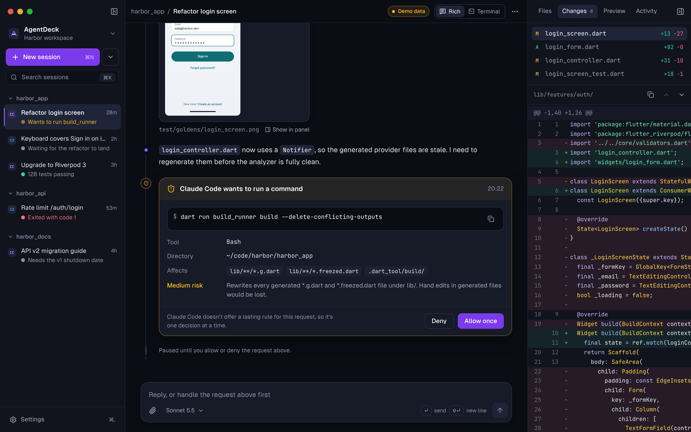
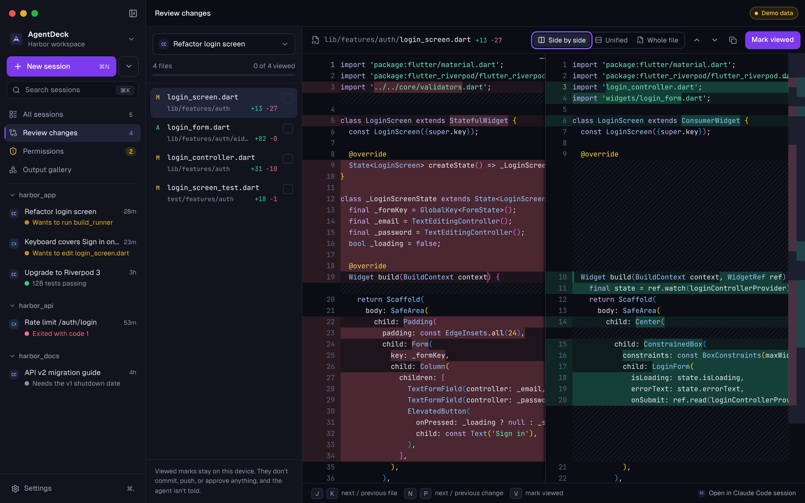
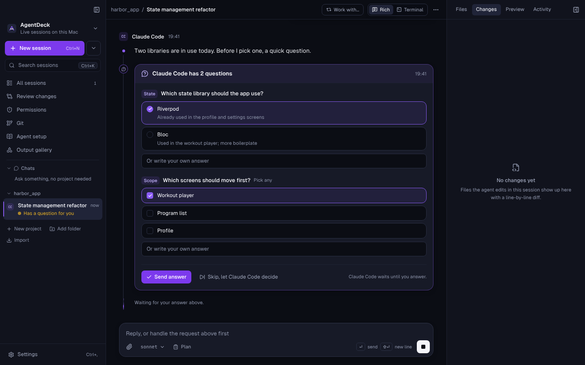
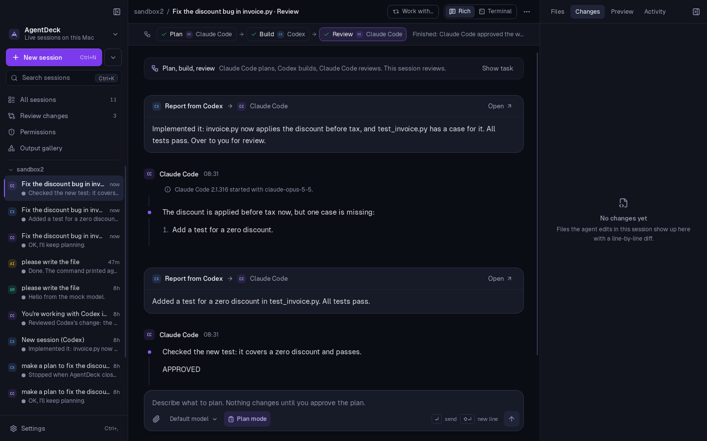
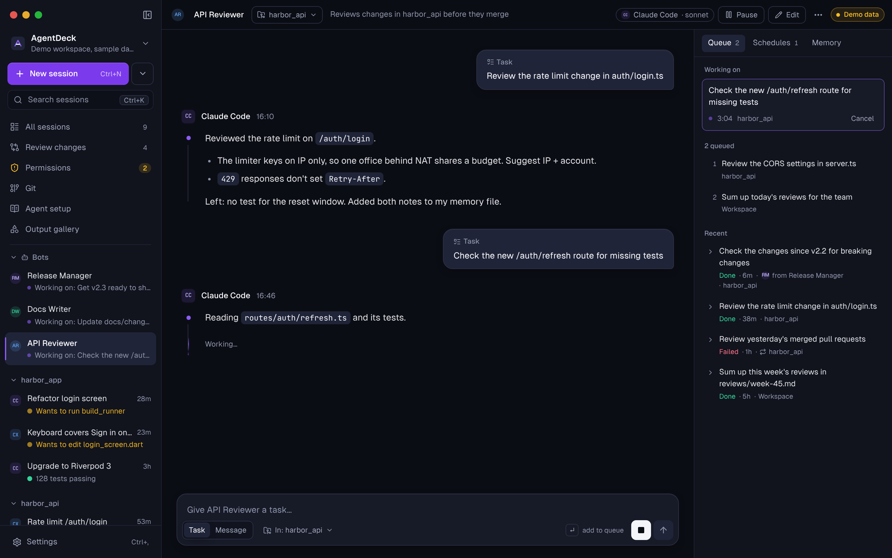
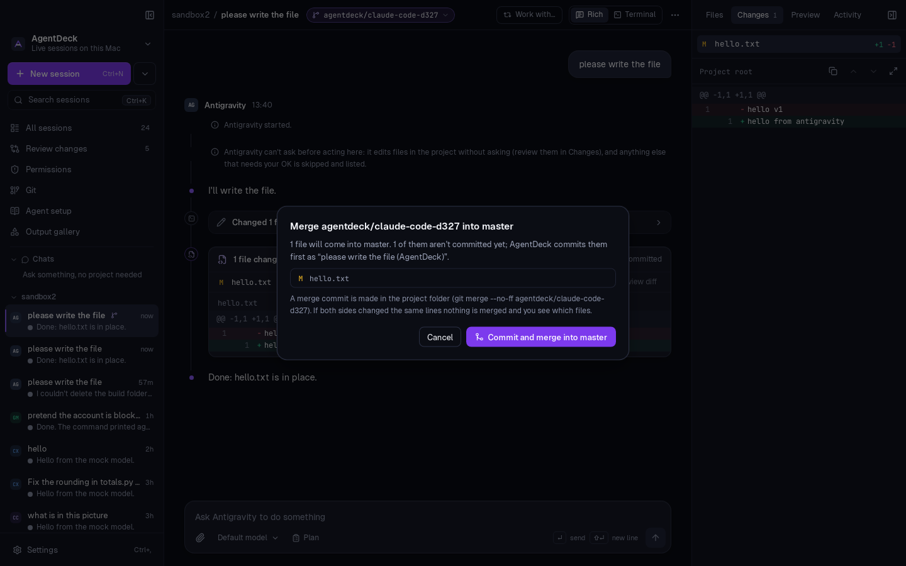
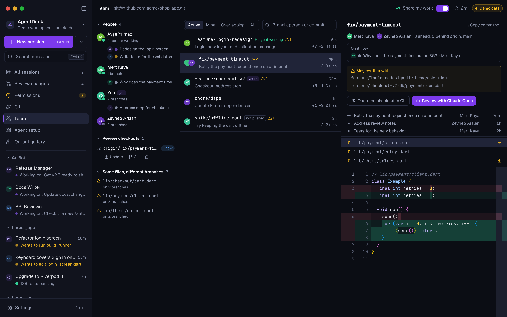
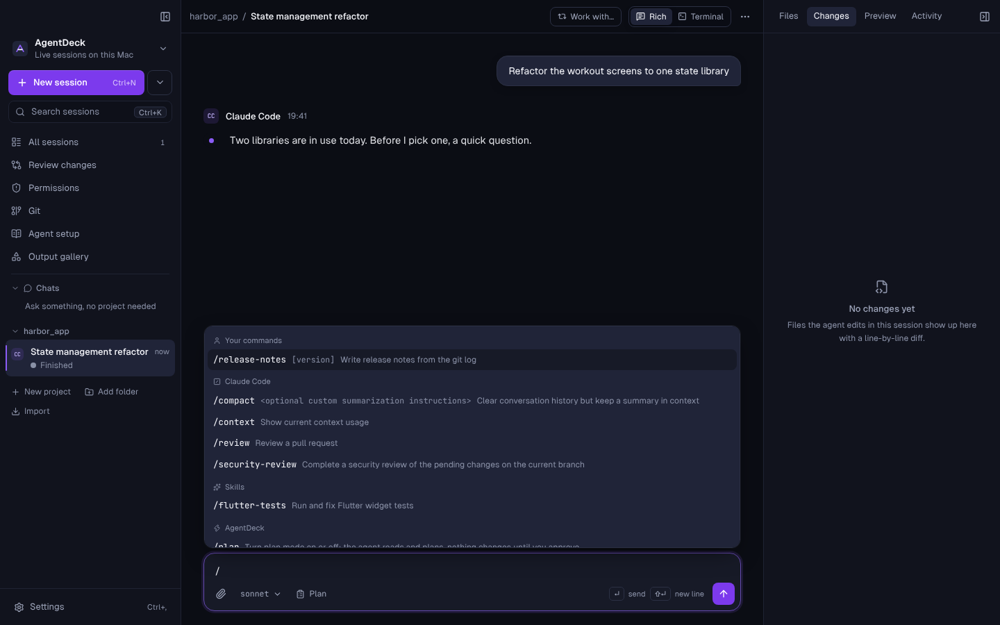
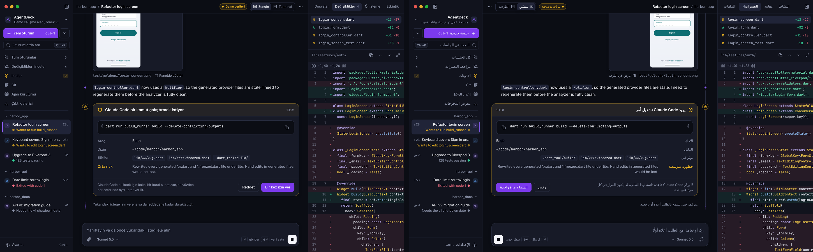

<div align="center">

**English** · [Türkçe](docs/readme/README.tr.md) · [Deutsch](docs/readme/README.de.md) · [Русский](docs/readme/README.ru.md) · [Español](docs/readme/README.es.md) · [Français](docs/readme/README.fr.md) · [Português](docs/readme/README.pt.md) · [简体中文](docs/readme/README.zh.md) · [日本語](docs/readme/README.ja.md) · [한국어](docs/readme/README.ko.md) · [العربية](docs/readme/README.ar.md)

# AgentDeck

**One Mac workspace for every AI coding agent you already use.**

Run Claude Code, Codex, Gemini CLI, Kimi Code and your own models side by side. Read their work as clean, structured output, review every diff, answer their questions and approvals in one place, and let them plan, build and review each other's work.

Your CLIs. Your accounts. No API keys required.

[Download for Mac](https://github.com/kalismeras61/agentdeck/releases/latest) · [What's new](https://github.com/kalismeras61/agentdeck/releases) · [How it works](#how-it-works) · [Build from source](#build-from-source)




</div>

## Why AgentDeck

Coding agents are great in a terminal, until you run three of them across five projects. Approvals scroll away, diffs are buried in logs, and getting one agent to check another's work means copy and paste.

AgentDeck keeps the agents exactly as they are and gives them a proper workspace:

- **It runs the real CLIs.** `claude`, `codex`, `gemini` start from your own install, with the same PATH, config and sign-in as in Terminal. If it works in your terminal, it works here.
- **It never touches your credentials.** Each agent signs in through its own flow. AgentDeck doesn't read, store or send tokens; the API keys you add for your own models stay in the macOS Keychain.
- **Everything stays on your Mac.** Sessions live in a local SQLite database. No account, no telemetry, no server. Team features go through the git remote you already push to, and only when you turn sharing on.

## What you can do

### Work with any agent, in any project

Every project is a folder; every session is one agent working in it. Switch agents before the first message, pick from every model each agent offers, and switch models mid-conversation. Start a chat without a project, move sessions between projects, rename them, or import the sessions Claude Code, Codex and Gemini CLI already saved on your Mac; they pick up the same conversation.

Choose how hard the agent thinks, too. Claude Code and Codex get an **effort** setting next to the model (low to max, only the levels that model supports). The menu shows the effort the agent is using right now, a change applies immediately while Claude Code works, and Settings sets the effort new sessions start with.

### Review what changed, the way you review a pull request

Every file an agent touches shows up with a side-by-side or unified diff, file by file, with keyboard navigation and "viewed" marks. Nothing is committed or pushed for you.

Screenshots and images an agent takes or looks at (a simulator screenshot, a rendered page, an image it reads) appear right in the conversation and in the Preview tab; click one to see it full size.



### Approve, deny, or let it ask

Commands and edits that need your OK appear as cards that say what will run, where, what it affects and how risky it is. Plan mode lets an agent read and propose before it changes anything. Each agent also has an approval level, in the composer and in Settings: ask every time, let file edits go ahead, Auto (ordinary edits and commands go ahead, risky ones and anything outside the project still wait), or everything. When an agent has a question (Claude Code's AskUserQuestion, Codex's request_user_input), you get a real form: pick an option, several, or write your own.



### Let agents work together

- **Workflows: plan → build → review.** Put any agent on each stage, for example Claude Code plans, Codex builds, Claude Code reviews. Each stage hands over as soon as it's done, review notes go straight back to the builder, and it stops when the reviewer writes APPROVED. Ordinary requests are approved for the agents; risky ones (deleting, pushing, deploying, credentials, anything outside the project) still wait for you.
- **Hand off.** Send any plan or reply to another agent in one click.
- **Relay.** Two agents talk to each other until one says DONE.



### Bots that keep working

A bot is an agent that stays. Give it a name, a job, instructions and an agent and model (Claude Code, Codex, Gemini CLI, Grok Build, Kimi Code, Antigravity or your own models), then hand it tasks. It works through them in the background while you do something else.

- **A place of its own.** Every bot has its own folder (`~/AgentDeck/Bots/<name>`) and works there unless a task names a project. Point any task at any project; the bot keeps a separate conversation for each place, so it remembers what it did where.
- **A task queue.** Add tasks while the bot is busy; it runs them one at a time. Pause, resume, cancel or retry, and each finished task keeps the bot's report as its result.
- **Memory.** Every bot keeps a short memory file in its folder. It reads it at the start of each task and writes down what's worth remembering: conventions, decisions, where things are, what you prefer. You can read and edit it on the bot's page.
- **Schedules.** "Weekdays at 9:00: review yesterday's merged pull requests", "every 6 hours: look for flaky tests". Each run lands in the queue like any task.
- **A manager bot.** Bots can hand parts of a task to other bots and wait for their results, through AgentDeck's own tools (`list_bots`, `delegate_task`, `wait_for_tasks`). A lead bot can split the work between a reviewer, a tester and a writer and put their reports together.
- **Orchestration across models.** Let one model lead and others do the work: a manager on your strongest model plans and checks, builders on Opus, Sonnet, Codex or Gemini write the code. Give a bot model choices and its manager picks per task (a quicker model for simple work, a stronger one for hard work, and how hard it thinks). Turn on "Each task in its own worktree" and every task works on a fresh branch, so several builders can work on one repository at the same time without stepping on each other. Each bot shows what its tasks used (tasks, tokens, cost at API prices) next to its agent's plan limits.
- **Unattended, not unchecked.** While a bot works on a task, ordinary requests are approved for it inside its folder and the task's project. Anything risky (deleting, pushing, deploying, credentials, anything elsewhere) and every question waits for you, and the bot shows "Needs you" in the sidebar.
- **Telegram.** Connect a Telegram bot of your own (a token from @BotFather, kept in your keychain) and pair your chat with a code. Then write a task from your phone and the bot's answer comes back there; start with a bot's name ("Reviewer: …") to pick one. When a bot needs you, the risky step, the question or the plan arrives with buttons: allow, deny, pick an answer. AgentDeck asks Telegram for messages itself, so nothing on your Mac is opened to the internet, and only chats you paired are answered.

- **Connections.** Bots can do more than code. In Settings → Connections add a browser (Playwright), GitHub, Notion, your Mac's Calendar, Reminders, Mail and Notes (through the apps and the accounts you already have in them), or any MCP server by command or address, each with your own account; tokens stay in your keychain. Then pick per bot what it may use. While a bot works on a task, what a connection reads is allowed; what it changes (a pull request merged, an event added, a mail draft opened) waits for you, unless you let that connection act on its own. Mail is never sent by a bot.
- **Triggers.** Besides schedules and Telegram, a bot gets work when a web page changes (a price, an announcement), new files land in a folder, an issue or pull request gets the `agentdeck` label in your repository, or a script on your Mac calls its hook (`curl -X POST http://127.0.0.1:47810/hooks/…`). Bots can also tell you something right away with `notify_me`, on Telegram and as a notification.
- **Ready-made bots.** Start from a Researcher, an Inbox assistant, a Day planner, a Social media writer, a Watcher or a Developer, and change what you like.



### Isolate work in git worktrees

Start a session in its own worktree and branch, so an agent can't step on your working copy. See the branch graph in the Git view, then merge the worktree back (with a clear warning when both sides changed the same lines) or throw it away.



### See your team's branches, and review them locally

The Team view (⌘⇧U) reads the project's own git remote, so there's no server and no account. For every branch on the remote it shows who has commits on it, how far it is from `main`, which files it changes and, most usefully, **which other branches change the same files**, so you see a conflict coming before anyone merges.

- **Who is on what, right now.** Turn on *Share my work* and AgentDeck pushes a tiny file to `refs/agentdeck/presence/<you>` (outside your branches, never in a pull request): the branch you're on and what your agent sessions are doing. Teammates who share too show up online, with their agents working, waiting or idle on each branch. You see exactly what will be shared before it's turned on; turning it off removes it from the remote.
- **Read any branch without switching.** Pick a branch for its commits and a diff of every file against where it forked.
- **Check it out to run it.** *Check out locally* puts the branch in its own folder next to the project (`<project>.worktrees/review-<branch>`), so your working copy isn't touched. When the teammate pushes again, *Update* fast-forwards it.
- **Let an agent review it.** *Review with Claude Code* (or your default agent) checks it out and opens a session there with a review request ready to send.



### Every command at your fingertips

Type `/` in the message box for the agent's own commands in that folder (Claude Code's built-ins, your custom commands and skills, Gemini CLI's commands, your Codex prompts) plus AgentDeck's (`/plan`, `/terminal`, `/workflow`, `/git` …).



### And the rest

- **Agent setup.** Edit `CLAUDE.md`, `AGENTS.md`, `GEMINI.md`, skills, commands and subagents, global and per project, in one tree.
- **Smart terminal.** Your own shell in the project folder. Ask any agent about the selection or the last 80 lines, with a one-click "Explain this error".
- **Attach anything.** Drop files or folders, paste a screenshot, or pick files. Images reach the agent as images.
- **Your own models.** DeepSeek, Kimi, GLM (Z.ai), Ollama, LM Studio, OpenRouter or any OpenAI- or Anthropic-compatible endpoint, with the same approvals, plan mode and workflows.
- **Plan limits at a glance.** Under the message box, Claude Code and Codex sessions show how much of your 5-hour and weekly limits you've used and when they reset.
- **Sign in where it fails.** When an agent needs a login, a button runs its own sign-in in a built-in terminal and sends your message again.
- **Updates itself.** New versions are signed and notarized, and each update is checked against a key built into the app before it installs.

### In your language

The whole interface is available in **English, Türkçe, Deutsch, Русский, Español, Français, Português, 简体中文, 日本語, 한국어 and العربية**, with a right-to-left layout for Arabic. AgentDeck follows your Mac's language, or you pick one in Settings → Appearance. Agent replies, code, commands and file names are never translated, and agents answer in whatever language you write to them.



## Light on your Mac

AgentDeck is a native Tauri app: a small Rust core and macOS's own WebKit, no bundled browser engine.

| | Measured on a Mac (release build, Activity Monitor) |
|---|---|
| Download | 22 MB disk image (Apple Silicon + Intel in one app) |
| Installed | 50 MB |
| Memory, AgentDeck itself | ~31 MB app + ~207 MB interface + ~18 MB system helpers ≈ **256 MB** |
| CPU while idle | **0.1 %**, no idle wake-ups |
| Startup | Interface loads a 446 KB main bundle; review, terminal, gallery and settings load when opened |

The agents run as their own processes and use their own memory, roughly 140–210 MB each while working (measured on Linux: Claude Code ~188 MB, Codex ~159 MB). To keep that in check, an agent that has been idle for 10 minutes is closed (its conversation continues when you write again), at most 6 stay open at once, and long histories load 80 turns at a time.

## Supported agents

| Agent | How AgentDeck talks to it | Sign-in |
|---|---|---|
| **Claude Code** | `claude` with stream-json and its permission prompt tool | Claude Pro, Max, Team or Enterprise, or Anthropic Console |
| **Codex** | `codex app-server`, JSON-RPC over stdio | ChatGPT plan or OpenAI API key |
| **Gemini CLI** | Agent Client Protocol | Google Workspace or Cloud account, or a Gemini API key |
| **Grok Build** | Agent Client Protocol | xAI account or API key |
| **Kimi Code** | `kimi acp`, Agent Client Protocol | Kimi Code plan or Moonshot AI API key |
| **Antigravity** *(experimental, off by default)* | `agy` headless stream-json | Google account; see the note in Settings about Google's terms |
| **Your models** | AgentDeck's built-in agent, or inside Claude Code for Anthropic-compatible APIs | API key in your Keychain |

Install at least one. The first-run screen shows which ones are on your Mac and installs or signs in to the rest with each agent's official command, in Terminal, where you can see what it does.

## Install

1. Download the latest `AgentDeck-<version>.dmg` from [Releases](https://github.com/kalismeras61/agentdeck/releases/latest).
2. Drag AgentDeck to Applications and open it. It's signed and notarized, so it opens with a double-click.
3. Follow **Get started** to set up an agent, then open a project folder.

macOS 12 or later, Apple Silicon or Intel.

## How it works

```
┌──────────────────────── AgentDeck (Tauri app) ────────────────────────┐
│  React UI: conversation, diffs, approvals, questions, workflows       │
│                │  validated, provider-neutral events (Zod)            │
│  Rust core: sessions · SQLite · git · PTY · workflow engine           │
└──────┬──────────────┬──────────────┬──────────────┬───────────────────┘
       │ stream-json  │ JSON-RPC     │ ACP          │ OpenAI / Anthropic API
       ▼              ▼              ▼              ▼
   claude          codex app-server  gemini, grok,  your models
                                     kimi
   (your install, your sign-in, your folder)
```

- Each agent runs as a child process in the session's folder, with your login shell's environment.
- Their output is stored as-is, then normalized into one event stream (messages, tool calls, diffs, approvals, questions, plans) and validated before anything is rendered. Anything malformed is shown as a clear error, never executed.
- Approvals are answered by you, by a workflow or bot for ordinary requests, or by the approval level you chose for an agent. Nothing dangerous is approved for you unless you set an agent to Everything.
- The frontend has no shell access: it can only call AgentDeck's own narrow commands.

## Build from source

Requirements: Node 22+, Rust 1.77+, and the Xcode command line tools.

```bash
npm install

npm run dev                 # web preview with labeled demo data, http://localhost:1420
npm run tauri dev           # desktop app

# Checks
npm run typecheck && npm run lint && npm test
(cd src-tauri && cargo fmt --check && cargo clippy && cargo test)

# End to end with the real CLIs against local stand-in APIs (no accounts needed)
python3 scripts/mock_anthropic.py 8787 & python3 scripts/mock_openai.py 8788 & python3 scripts/mock_gemini.py 8789 &
(cd src-tauri && AGENTDECK_IT=1 cargo test -- --ignored --test-threads=1)

npm run tauri build         # .app / .dmg
```

Releases (signed, notarized, universal, self-updating) are described in [docs/RELEASING.md](docs/RELEASING.md); what's built and how each part is verified in [docs/STATUS.md](docs/STATUS.md); the agent protocols in [docs/PROVIDERS.md](docs/PROVIDERS.md).

<details>
<summary><b>Keyboard</b></summary>

| Action | Keys |
|---|---|
| New session | ⌘N |
| Search sessions | ⌘K |
| Toggle sidebar / context panel | ⌘B / ⌘. |
| Context tabs | ⌘1 … ⌘4 |
| Previous / next session | ⌥↑ / ⌥↓ |
| Focus message box | ⌘L |
| Commands | / at the start of a message |
| Rich / Terminal view | ⌘⇧R / ⌘⇧T |
| All sessions / Review / Permissions / Git / Team / Agent setup / Gallery | ⌘⇧S / ⌘⇧D / ⌘⇧A / ⌘⇧H / ⌘⇧U / ⌘⇧E / ⌘⇧G |
| Settings | ⌘, |
| Rename session | double-click the title, or F2 in the sidebar |
| Review: next/prev file, change, mark viewed | J / K, N / P, V |
| Send / new line | ↵ / ⇧↵ |

Permission requests deliberately have no shortcut.

</details>

<details>
<summary><b>Project layout</b></summary>

```
src/                     React app
  lib/events.ts          normalized event schema and validation
  lib/claude.ts, codex.ts, acp.ts, api.ts, normalize.ts   agent logs → events
  components/            sidebar, conversation, composer, terminal, panels
  components/blocks/     renderers: markdown, code, diff, tools, approvals, questions, plans, workflows
  views/                 review, permissions, git, agent setup, settings, get started
  locales/               interface translations (English text is the key)
src-tauri/src/           Rust core
  claude.rs, codex.rs, acp.rs, agy.rs, api.rs   one manager per agent protocol
  flow.rs, relay.rs      workflows and relays
  git.rs, pty.rs, db.rs, import.rs, context.rs, commands.rs, updates.rs
scripts/                 stand-in APIs for tests, release scripts
docs/                    status, providers, releasing, screenshots
```

Stack: Tauri 2 (Rust), React 19, TypeScript (strict), Vite, Tailwind CSS 4, Radix UI, Zustand, Zod, Shiki, Monaco, xterm.js, SQLite.

</details>

## Contributing

Issues and pull requests are welcome. Run the checks above before opening a PR, and keep UI text short and plain.

**Translations.** The interface translations were made with the help of AI and checked by tests, not yet by native speakers, so corrections are very welcome: edit `src/locales/<language>.json` and run `node scripts/i18n-validate.mjs`. New interface text goes through `t()`; see [docs/I18N.md](docs/I18N.md).

AgentDeck is offered under the AGPL and, separately, under a commercial license. To keep that possible, contributors are asked to sign a contributor license agreement on their first pull request.

## License

AgentDeck is free software under the [GNU Affero General Public License v3.0](LICENSE). You can use, study, change and share it. If you run a modified version for others over a network, you must offer them its source under the same license.

For a commercial license without the AGPL's obligations (for example, to ship AgentDeck inside a closed product), get in touch through the repository.

Claude Code, Codex, Gemini CLI, Grok Build, Kimi Code and Antigravity are products of their respective owners. AgentDeck isn't affiliated with or endorsed by them; it runs your own installed copies.
